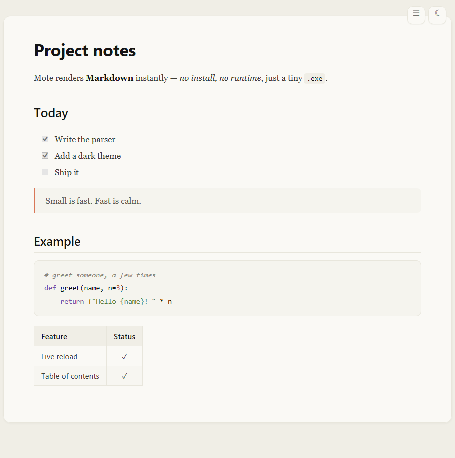
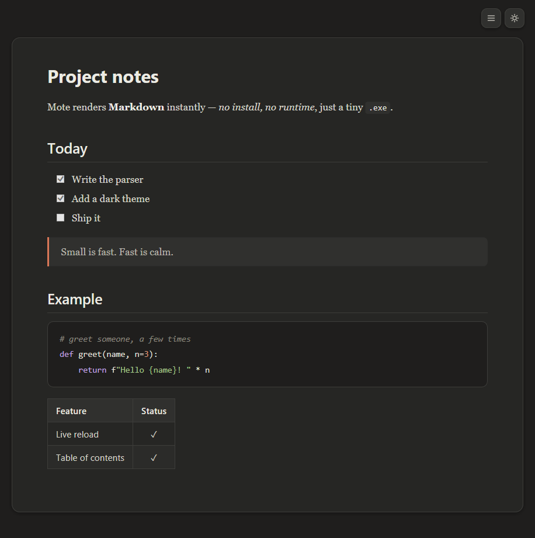

<p align="center"></p>

# Mote

**A tiny, fast Markdown reader for Windows. The whole app is a ~50 KB `.exe`.**

No installer, no runtime to download, no Electron. Double-click a `.md` file and it is on screen before you blink.

| Light | Dark |
|---|---|
|  |  |

## Features

- **Tiny**: one ~50 KB executable, nothing else. Uses the .NET Framework that already ships with Windows 10/11.
- **Live reload**: the view refreshes the moment the file changes and keeps your scroll position. Handy for watching notes or AI-generated docs as they are written.
- **Light & dark theme**: follows your Windows theme on first run, toggle any time. Title bar and scrollbars match.
- **Table of contents**: a click-to-jump outline of your headings.
- **Code blocks**: simple syntax highlighting and a one-click *Copy* button.
- **The Markdown you actually use**: headings, bold/italic/strikethrough, links, images, lists (nested), task lists, tables (with alignment), blockquotes, fenced code, horizontal rules.
- **Remembers** window size, position, theme and outline state.
- **English UI by default**, Turkish automatically when Windows is in Turkish.

## Download

Grab `Mote.exe` from the [latest release](../../releases/latest) and put it anywhere. That's it.

> Windows SmartScreen may warn about an unknown publisher the first time (the exe isn't code-signed). Click *More info → Run anyway*, or build it yourself from source (below).

**Make it the default for `.md` files:** right-click any `.md` file → *Open with* → *Choose another app* → *More apps* → *Look for another app on this PC* → pick `Mote.exe` → tick *Always use this app*.

## Shortcuts

| Key | Action |
|---|---|
| `Ctrl+O` | Open file (or just drag & drop onto the window) |
| `Ctrl+D` | Toggle light / dark theme |
| `Ctrl+T` | Toggle table of contents |
| `F5` | Reload |
| `Ctrl+F` | Find |
| `Ctrl+Mouse wheel` | Zoom |
| `Ctrl+P` | Print |

Links to other `.md` files open in Mote; web links open in your default browser.

## Build from source

No SDK or Visual Studio needed. The C# compiler that comes with Windows is enough:

```powershell
git clone https://github.com/nihat3371/mote
cd mote
.\build.ps1
```

Everything lives in a single file, [`Mote.cs`](Mote.cs): the window, the Markdown parser and the styles.

## Limitations

Kept small on purpose:

- Raw HTML inside Markdown is shown as text, not rendered.
- Rendering uses the built-in Windows web control, so very exotic CSS/Markdown extensions (math, diagrams, footnotes) are not supported.
- Windows only.

## Family

Small, fast, calm Windows tools: Mote · [Glint](https://github.com/nihat3371/glint) (ask Claude about your screen).

## License

[MIT](LICENSE)
